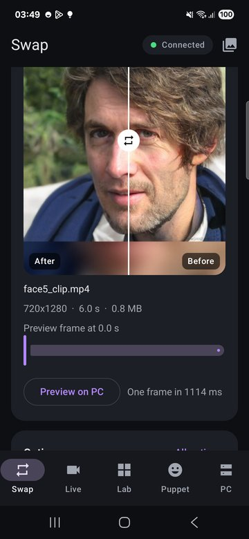
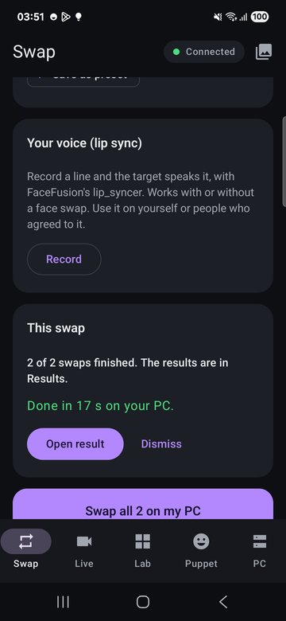
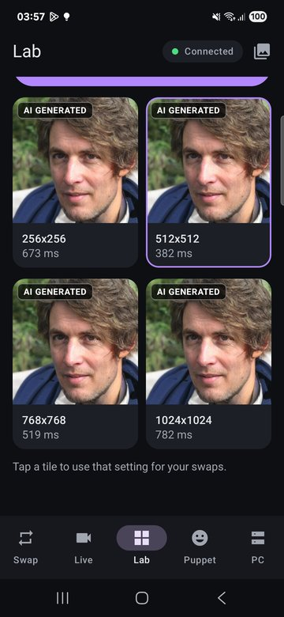
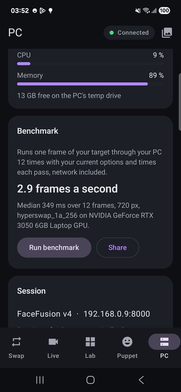
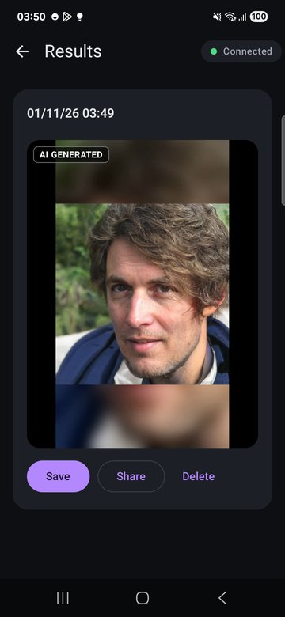
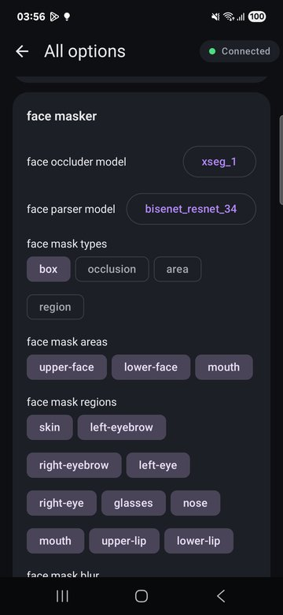
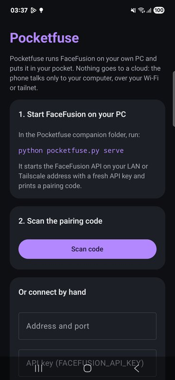
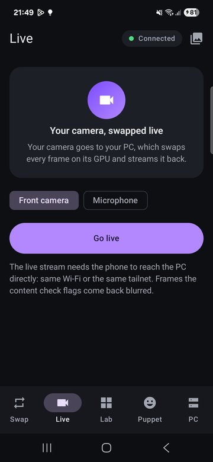

Pocketfuse
==========

**Your own FaceFusion PC, in your pocket.** Pocketfuse is an Android app and a small Python companion
built on the FaceFusion v4 API. The PC does the work on its GPU; the phone is where your photos, your
camera and your attention already are. Nothing goes to a cloud: the phone talks only to your computer,
over your Wi-Fi or your tailnet.

Built for the [FaceFusion v4 Challenge](https://github.com/facefusion/facefusion/tree/v4-challenge).
Runs against the unmodified `v4-challenge` branch, and is tested against the `v4` branch as well.

> **Demo video: [demo.mp4](demo.mp4)** (3.5 minutes, recorded from a real phone against a real
> FaceFusion server). Every face in it is AI generated, and every manipulated frame carries a visible
> **AI GENERATED** label.


| Preview, before and after | Several targets at once | Lab: one setting, side by side | Your PC, measured |
|---|---|---|---|
|  |  |  |  |
| **Result, labelled** | **Every option the server offers** | **Pairing** | **Live** |
|  |  |  |  |

All faces in these screenshots and in the demo are AI generated (StyleGAN); none is a real person.


Why a phone
-----------

The CLI is great at a desk. Most of the time you are not at the desk.

- **Share to swap.** Share a video from your gallery, a chat or any app to Pocketfuse, pick a face,
  tap Swap. Upload, job, progress and download run in a foreground service with notifications, so you
  can lock the phone and come back to the result.
- **Live.** Your phone camera goes to the PC over WebRTC, every frame is swapped on the GPU and
  streamed back. A phone you already carry becomes the camera. Video goes only over WebRTC, as the
  developer guide asks; the `/stream` WebSocket carries single images (preview, Lab, Puppet).
- **Lab.** Compare one setting side by side on a frame of your target: every swap model, pixel boost,
  weight or enhancer, one tile each, back in seconds. The CLI can try one setting per run. Tap the
  winner and it becomes the setting for your swaps.
- **Dub.** Record a line on the phone and the target speaks it, with FaceFusion's `lip_syncer`: the
  phone's microphone becomes a source. Works with a face swap or on its own.
- **Puppet.** The front camera reads your head pose and expression on the phone (MediaPipe) and those
  14 numbers drive FaceFusion's `face_editor` on a portrait, frame after frame. Your camera image never
  leaves the phone; only the numbers and the portrait do.
- **PC at a glance.** GPU load, VRAM, temperature, CPU, memory and disk from `/metrics`, the session,
  and the jobs the server holds.


API coverage
------------

| Area | Where Pocketfuse uses it |
|------|--------------------------|
| Sessions | open with the API key, rotate both tokens every 3 minutes (a session lives 10 minutes on `v4-challenge`, 5 on `v4`), treat `401` and `426` as "session lost" and never retry the failed call, close on unpair |
| State | every swap, preview, live stream, lab tile and puppet frame sets its options; only changed keys are sent |
| Capabilities | the **All options** screen is built entirely from `GET /capabilities`: a slider for numeric ranges, chips for lists, a menu for choices, a text field for free input. A newer FaceFusion shows its new options with no app update |
| Assets | multipart upload with progress, `capture` to show the face the PC found in each source photo (or warn that it found none, before a job fails on it), `download` of outputs, uploads remembered per session |
| Jobs | create, add step, submit, run, poll, find the output asset named after the job; also used to download models before streaming (see below) |
| Stream | WebRTC (`POST /stream`, `DELETE /stream`) for Live; the `/stream` WebSocket for preview, Lab and Puppet |
| Metrics | the `/metrics` WebSocket feeds the PC dashboard |


Setup
-----

The short version is below. Step by step, with every screen and a troubleshooting table:
**[docs/USER-GUIDE.md](docs/USER-GUIDE.md)**.

You need a PC with FaceFusion v4 installed (see the
[installation guide](https://docs.facefusion.io/installation)) and an Android phone (10 or newer, arm64)
on the same Wi-Fi, or on the same [Tailscale](https://tailscale.com) tailnet.

### 1. The companion, on the PC

```
git clone https://github.com/AbrahamPaulJ/pocketfuse
cd pocketfuse/companion
pip install -r requirements.txt
python pocketfuse.py serve --facefusion-path ../../facefusion
```

`serve` starts the FaceFusion API on your tailnet or LAN address (never a public one), with an API key,
waits until it answers, and prints a pairing QR code and link. Any extra arguments go to FaceFusion,
for example `--execution-providers cuda`.

- The key is fresh for every run. Set `FACEFUSION_API_KEY` to keep phones paired across restarts.
- `serve` runs FaceFusion with `--video-memory-strategy moderate` unless you pass your own: the default
  `strict` unloads the models during and after every job, which made a 2 s clip take 30 s on an RTX 3050
  Laptop instead of 9 s.
- On Windows with `pip install onnxruntime-gpu[cuda,cudnn]`, `serve` puts the pip CUDA libraries on the
  server's `PATH`; without that, FaceFusion silently falls back to the CPU.
- `python pocketfuse.py probe --source-path face.jpg --target-path clip.mp4` checks a server end to end
  (16 steps, from sessions to the stream socket) and tells you what fails.
- `python pocketfuse.py pair` prints a pairing code for a server you started yourself.

### 2. The app

Install the APK from the [releases](https://github.com/AbrahamPaulJ/pocketfuse/releases), open it and
scan the code. Or type the address and key by hand.

Build it yourself: `cd android && ./gradlew assembleDebug` (JDK 17, Android SDK 35).


Security
--------

FaceFusion v4 is a service layer that has to be secure, so the client must not undo that.

- Tokens travel only in the `Authorization` header and the WebSocket subprotocol, never in a URL, a log
  or a crash report. Rotated tokens are dropped at once.
- The API key is encrypted on the phone with a key that lives in the Android Keystore; backups are off.
- The companion refuses public addresses and always sets an API key. The app shows how you are
  connected (tailnet, LAN, public) and warns when there is no key.
- Upload limits (512 MiB, 4096 px, accepted formats from `/capabilities`) are checked on the phone before
  a byte is sent; photos above 4096 px are scaled down on the phone.
- The content analyser is untouched. Frames it flags come back blurred, and the app says so.


Things the app handles so you do not have to
--------------------------------------------

Found while building, each written up for the FaceFusion team:

- **Phone videos and `moov`.** Most phone cameras write the MP4 index at the end; the `v4` branch rejects
  those with `415`. Pocketfuse moves it to the front on the phone (a streaming rewrite of the chunk
  offset tables, tested), as the developer guide suggests.
- **The stream and the face selector.** Under the default `face_selector_mode = reference` the stream
  returns frames unprocessed (it has no reference frame). Pocketfuse uses `one` or `many` for streaming.
- **Models before streaming.** A stream frame that needs a model the PC has not downloaded crashes the
  socket, and only a job downloads models. The first time a combination is streamed, Pocketfuse runs a
  one-image warm-up job, then remembers it.
- **WebRTC without STUN.** The offer is sent only after ICE gathering completes, transceivers are added
  in the order the server expects, and VP8 is offered first (no AV1) so every phone decodes in hardware.
- **The `v4` branch.** At the time of testing its WebRTC peer stopped before the track opened, so no
  frame was processed and Live shows a clear hint instead of hanging. Its `capture` needs a frame index even for photos and answers
  `multipart/mixed`; Pocketfuse sends one and reads both formats.


Beta feedback
-------------

Eight findings from building against the v4 API, each re-checked on `v4-challenge` and the latest `v4`,
with repro scripts: [docs/BETA-FEEDBACK.md](docs/BETA-FEEDBACK.md). The two that matter most: a WebRTC
stream can crash the whole API on CUDA (the content analyser runs without a lock), and on `v4` a session
whose stream crashed can never be closed by its client.


Tests
-----

| Suite | What | Run |
|-------|------|-----|
| Android JVM | 49 tests: client contract against a mock server, real captured `/capabilities` and `/metrics`, pairing, every error status has a sentence, faststart, SDP, puppet maths; plus a render of every screen (Roborazzi) | `./gradlew testDebugUnitTest` |
| On the phone, against a real server | 12 tests over the real network path: sessions, wrong key, capture and the face check, stream preview, full swap job, lip sync to a voice, metrics socket, token rotation, every call made from the main thread, puppet values accepted by the server, model warm-up, and a WebRTC stream that must come back processed. 12/12 on `v4-challenge`; 11/12 on `v4` (the WebRTC issue above) | `tools/e2e_phone.ps1 -Serial <adb serial> -Pairing <link>` |
| Companion | flake8 and mypy with FaceFusion's own settings, 15 tests, plus a live probe test | `pytest` |

CI runs the companion checks and the Android build and JVM tests on every push.


Credits
-------

- [FaceFusion](https://github.com/facefusion/facefusion) by Henry Ruhs and contributors: the engine,
  the models and the API. Pocketfuse is built on FaceFusion and is not affiliated with it.
- [MediaPipe Face Landmarker](https://ai.google.dev/edge/mediapipe/solutions/vision/face_landmarker)
  (Apache-2.0), [libwebrtc via stream-webrtc-android](https://github.com/GetStream/webrtc-android),
  OkHttp, kotlinx.serialization, ML Kit barcode scanning, [segno](https://github.com/heuer/segno).

**AI tools used:** built with Claude Code (Anthropic models), as the challenge terms ask to disclose.
OpenAI Codex and OpenCode were tried for two delegated tasks; none of their output was kept. Every
change was reviewed, tested on a real phone against a real server, and is covered by the suites above.


Licence
-------

OpenRAIL-AS, see [LICENSE.md](LICENSE.md). Use it only on yourself or people who consented, and label
what you publish as AI generated.
